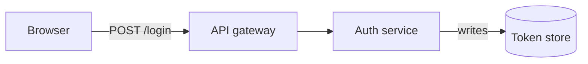
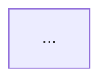

## Workflow

| # | Step | Status | Notes |
|---|------|--------|-------|
| 10 | Requirements | done | EARS acceptance criteria, see ## Requirements |
| 30 | Assessment | done | 70% reuses cmd_index; gaps = fm list/map parsing, glob match, fingerprint |
| 40 | POC | skipped | No unknown blocks the design; the two open alternatives are Architecture decisions, not experiments |
| 50 | Domain | done | 7 canonical terms + 5 invariants fixed; see ## Domain |
| 60 | Architecture | done | D1 bash3.2, D2 no globs, D3 lib.sh split, D4 awk typed stream, D5 cksum |
| 70 | Tests | done | 26 cases traced to R-numbers; dual-target host+container; see ## Tests |
| 80 | Subtasks | done | 4 sub-tasks: PLUG-002..005; PLUG-001 converted to epic |
| 90 | Implementation | skipped | Delegated to sub-tasks PLUG-002..005 — an epic has no code of its own |
| 100 | Tech Debt | done | PLUG-006 raised: config duplication + copy-pasted JSON reader |
| 110 | Reflection | done | repo CLAUDE.md: shell conventions, plugin-vs-dir, tasks, drift fixes |

## Description

Docs are often easier to understand as a diagram than as prose. Add diagram support
to the `docs-manager` plugin so a markdown doc can own a diagram that is kept in a
text source, cross-referenced to the rest of the project, and flagged when it goes
stale.

**Core constraint (decided during design discussion):** the plugin renders nothing
and depends on nothing external. A fenced diagram block is already rendered by the
*viewer* (GitHub, GitLab, VS Code, JetBrains, Obsidian, Claude artifacts), so there
is no missing capability to fill. The plugin manages diagram *sources* and their
*metadata*; drawing is delegated entirely to the reader's tool, or to a render
command the project itself supplies.

## Decisions (from design discussion, 2026-09-11)

1. **No renderer, no default rendering.** Zero external libs, zero Docker pulls,
   zero install steps. ASCII output explicitly rejected — unreadable, and the user
   stated they do not want to read ASCII diagrams.
2. **Format-agnostic.** The plugin only requires "a fenced code block with a
   language tag" and never parses the body. `mermaid` is the *recommended* value
   (widest free viewer support), not a hard-coded one — `d2`, `dot`, `plantuml`
   all work unchanged.
3. **Refs live in frontmatter, not in the fence.** Keeps the fence pure and
   portable, lets the link checker read refs as plain key-value data without
   parsing any diagram language, and lets a configured renderer inject
   `click`/`link` directives from the same source.
4. **Refs render as a caption list**, not (only) as clickable nodes — GitHub
   sanitizes Mermaid `click` anyway. A caption list is visible, greppable,
   diffable, link-checked, and works in every viewer including `cat`.
5. **Rendering is an optional port.** If the project sets a `render` command in
   its config, the plugin substitutes placeholders and shells out. The project
   owns the dependency, the pinning and the security surface.
6. **Staleness stamp lives in the `.diagram.md` frontmatter**, not inside a build
   artifact — it is a review record, renderer-agnostic, and survives uninstall.
7. **Lives in `docs-manager`**, not a new plugin — it reuses the frontmatter
   parser, `normalize_path`, the link checker and the AUTO-block rewrite machinery
   that `scripts/docs.sh` already has.

### Acceptance test for the "pluggable" constraint

> Uninstall the plugin. Nothing in the project breaks.

Fences still render, committed SVGs still open, `AUTO-DIAGRAM` blocks are inert
HTML comments. The project never learns what drew its pictures.

## Proposed design

### Files

```
docs/architecture/auth.md               <- doc, contains the AUTO-DIAGRAM block
docs/architecture/auth-flow.diagram.md  <- SOURCE: frontmatter + one fenced block
docs/architecture/auth-flow.svg         <- optional, only if project wires a renderer
```

### Diagram source format

````markdown
---
title: Auth flow
embeds: [architecture/auth.md]
watch:  [src/auth/**, src/api/gateway.ts]
refs:
  api:     file:src/api/gateway.ts
  authsvc: task:AUTH-12
  store:   term:refresh-token
stamp: a3f9c21
---


````

### Generated block in the doc

The fence is copied verbatim into the doc between markers, so the diagram shows up
inline wherever the doc is read. Machine-generated duplication inside a marked
block — same contract as the existing `AUTO-INDEX`.

````markdown
<!-- DIAGRAM:auth-flow.diagram.md -->
<!-- AUTO-DIAGRAM:START -->

**References** — API gateway -> [`src/api/gateway.ts`](...) · Auth service -> [AUTH-12](...)

⚠️ *may be stale — watched files changed since last review*
<!-- AUTO-DIAGRAM:END -->
````

### Ref schemes

`file:` `doc:` `task:` `term:` (glossary) `url:` `diagram:` (drill-down).
One resolver turns a scheme into a relative href; the **same** resolver validates
them, so `docs.sh links` must be extended to crawl `*.diagram.md` and report
`BROKEN REF: auth-flow.diagram.md -> task:AUTH-12`. Reuse `normalize_path`.

### Staleness flow

`watch:` globs declare what the diagram depicts. On build, fingerprint the matched
files into `stamp:`. `docs.sh diagram check` recomputes and compares: changed means
**suspect**, not wrong — badge in the doc, non-zero exit in CI. After review,
`docs.sh diagram bless <name>` re-stamps.

The valuable half is a `PostToolUse` hook that fires when an edited path matches any
diagram's `watch:` globs and warns on stderr — nudging Claude mid-session, while the
change is fresh, which is the only moment a diagram actually gets fixed.

### Config (renderer-agnostic, project-owned)

```json
{
  "docsDir": "docs",
  "diagrams": {
    "language": "mermaid",
    "render": "docker run --rm -v {dir}:/w --user {uid}:{gid} <project-pinned-image> -i /w/{in} -o /w/{out}",
    "output": "{name}.svg"
  }
}
```

No key named `mermaid`. No `.mermaid.json`. `render` absent means no rendering.

## Known constraints

- **No syntax validation without a renderer.** Mitigate with a two-line sanity
  check (fence non-empty, first token in a known-keywords list). Accept the rest.
- **GitHub sanitizes Mermaid `click`** — refs are only clickable in a built
  artifact. This is why the caption list exists.
- **`` kills links inside the SVG** — a doc must *link* to the
  SVG, never embed it as an image.
- **If a renderer is wired, the output must be committed** — a contributor without
  the plugin cannot regenerate it, so a gitignored artifact would be a broken link
  for everyone else.

## Proposed slicing (for the Subtasks step)

Three vertical cuts, mostly disjoint files, suitable for parallel sessions:

1. **Source format + AUTO-DIAGRAM block + back-refs** — the `.diagram.md` format,
   fence copying into docs, `embeds:` back-reference tracking.
2. **Refs resolution + link-check integration** — scheme resolver, caption list
   generation, extend `cmd_links` to crawl diagram sources.
3. **Staleness** — `watch:` globs, `stamp:`, `check`/`bless`, the PostToolUse hook.

Slice 1 is a prerequisite for 2 and 3; 2 and 3 are independent of each other.

## Related tech debt (flagged during discussion)

Config duplication across plugins: `.task-config.json` (`tasksDir`), whatever
`task-roadmap` reads (`.task-roadmap.json`, also `tasksDir`), and now a docs config.
Three files with overlapping keys, and the JSON `grep` reader is reimplemented per
plugin. Worth unifying into one config file with a section per plugin plus a single
shared config-reader script. Create a separate task for this at the Tech Debt step.

## Requirements

EARS-style. Each statement is a trigger/response pair intended to be directly
testable, so the BDD and Tests steps can consume them without re-interpretation.
"The tool" means `docs-manager/scripts/docs.sh`.

### Source recognition (ubiquitous)

- **R1** — The tool shall treat every file matching `*.diagram.md` under the
  configured `docsDir` as a diagram source.
- **R2** — The tool shall not parse, validate or rewrite the body of the fenced
  block, other than copying it verbatim.
- **R3** — The tool shall complete every command without requiring, invoking or
  installing any diagram-rendering software.
- **R4** — The tool shall accept any language tag on the fenced block, and its
  behaviour shall not differ between tags.

### Block generation (event-driven)

- **R5** — When `docs.sh diagram index` runs, the tool shall replace the content
  between `AUTO-DIAGRAM:START` and `AUTO-DIAGRAM:END` in each doc named by the
  source's `embeds:` field, and shall preserve every byte outside those markers.
- **R6** — When generating a block, the tool shall copy the source's fenced block
  verbatim, including its language tag.
- **R7** — When `docs.sh diagram index` runs twice with no intervening change to
  any source or watched file, the second run shall modify no file.
- **R8** — When `docs.sh diagram index --check` runs, the tool shall modify no
  file, and shall exit non-zero if any generated block differs from what it would
  generate.

### References (event-driven)

- **R9** — When a source declares `refs:`, the tool shall emit a `**References**`
  line in the generated block listing every ref as a markdown link, with each
  target resolved relative to the embedding doc.
- **R10** — When `docs.sh links` runs, the tool shall resolve every ref in every
  `*.diagram.md` and shall report each unresolvable one as
  `BROKEN REF: <source> -> <scheme>:<value>` and exit non-zero.
- **R11** — The tool shall support the ref schemes `file:`, `doc:`, `task:`,
  `term:`, `url:` and `diagram:`; a `url:` ref shall be emitted as a link and
  shall not be checked for existence.

### Staleness (event-driven / state-driven)

- **R12** — When `docs.sh diagram check` runs, the tool shall compute a
  fingerprint over the files matching the source's `watch:` patterns and shall
  report the diagram as stale if that fingerprint differs from its `stamp:` field.
- **R13** — While a diagram is stale, the tool shall include a staleness notice
  inside its generated block in every embedding doc.
- **R14** — When `docs.sh diagram bless <name>` runs, the tool shall write the
  current fingerprint into the source's `stamp:` field and shall leave all other
  content of that file unchanged.
- **R15** — When an `Edit`, `Write` or `MultiEdit` tool call modifies a file
  matching any diagram's `watch:` patterns, the hook shall emit a warning to
  stderr naming each affected diagram, and shall exit 0.
- **R16** — When a source declares no `watch:` field, the tool shall never report
  that diagram as stale.

### Optional rendering (optional-feature)

- **R17** — Where the project config defines `diagrams.render`, the tool shall
  substitute the placeholders `{in}`, `{out}`, `{dir}`, `{name}`, `{uid}` and
  `{gid}` and execute the resulting command.
- **R18** — Where `diagrams.render` is absent, the tool shall complete every
  command successfully and shall produce no rendered artifact.
- **R19** — Where a configured render command exits non-zero, the tool shall
  report the failure, shall leave any previously generated artifact untouched,
  and shall still write the generated block.

### Error handling (unwanted behaviour)

- **R20** — If a source's fenced block is absent, empty, or carries no language
  tag, then the tool shall report an error naming the file and exit non-zero.
- **R21** — If a doc named in `embeds:` does not exist, then the tool shall report
  it and exit non-zero.
- **R22** — If a `DIAGRAM:` marker names a source file that does not exist, then
  the tool shall report it and shall leave the existing generated block unchanged.

## Acceptance Criteria

1. **Uninstall test** — with the plugin removed, every doc still renders its
   diagram in any Mermaid-aware viewer, every committed artifact still opens, and
   the `AUTO-DIAGRAM` markers are inert HTML comments. Nothing in the project
   references the plugin.
2. **No-dependency test** — the full command set runs to success on a machine with
   no Node, no Docker, no diagram tooling of any kind (R3, R18).
3. **Format-swap test** — changing every fence from `mermaid` to `d2` changes no
   plugin behaviour and produces identical blocks apart from the tag (R4).
4. **Idempotency test** — `diagram index` run twice leaves a clean `git status`
   (R7).
5. **Round-trip staleness test** — touch a watched file → `check` reports stale
   and exits non-zero → `bless` → `check` reports clean (R12, R14).

## Assessment

Codebase readiness for the requirements above. Read: `docs-manager/scripts/docs.sh`
(all 157 lines), `docs-manager/CLAUDE.md`, `docs-manager/skills/docs-manager/SKILL.md`,
`task-roadmap/scripts/{generate.sh,regenerate-hook.sh}`, `task-roadmap/hooks/hooks.json`.

### Reusable as-is

| Asset | Location | Used for |
|---|---|---|
| `fm_field` | `docs.sh:20` | reading scalar frontmatter (`title`, `stamp`) |
| `normalize_path` | `docs.sh:38` | resolving refs relative to the embedding doc (R9) |
| AUTO-block rewrite | `cmd_index` `docs.sh:105-118` | the exact marker-replace pattern R5 needs |
| `--check` / `--write` mode split | `cmd_index:84-90` | R8 |
| idempotent diff-before-move | `docs.sh:116` | R7 comes almost free |
| hook shape | `task-roadmap/hooks/hooks.json` + `regenerate-hook.sh` | R15 |
| `json_str` config reader | `task-roadmap/scripts/generate.sh:28` | project config |

The `AUTO-INDEX` machinery is a near-exact template for `AUTO-DIAGRAM`. Two
behaviours there must be preserved verbatim (both are documented in
`docs-manager/CLAUDE.md` as "don't regress"): the generated block is passed to
`awk` via a **temp file read with `getline`**, never `awk -v` (which cannot carry
newlines), and the final write is diff-guarded so an unchanged file is not touched.

### Gaps — new work required

1. **Frontmatter parsing is scalar-only.** `fm_field` returns the first `key: value`
   match and cannot read `embeds: [a, b]` (inline list) or the nested `refs:` map.
   This is the single largest piece of new parsing. Two new readers needed:
   `fm_list` and `fm_map`.
2. **`/bin/bash` is bash 3.2** (verified: `3.2.57`, the macOS system bash, and
   `docs.sh:1` pins `#!/bin/bash`). **No associative arrays** — the `refs:` map must
   be carried as parallel indexed arrays or as `key<TAB>value` lines through a pipe.
   This constrains the design of `fm_map` and must not be discovered at implementation time.
3. **No glob matcher for `watch:`.** Patterns like `src/**` need matching without
   `globstar` (a bash 4 feature). Implement with `find` plus `case` prefix tests.
4. **No fingerprinting primitive.** Needed for R12/R14. `cksum` is POSIX and present
   on every target (verified); `shasum`/`sha1sum` are not portably guaranteed. Use
   `cksum` over the sorted list of matched paths plus their contents.
5. **No config reading in `docs.sh` at all** — `ROOT_DEFAULT="docs"` is hardcoded at
   `docs.sh:15`. `docsDir` and the `diagrams.*` block (R17/R18) need a reader.
   `task-roadmap` already has `json_str`; copying it is the third instance of the
   same function in this repo — see Tech Debt below.
6. **`docs-manager` has no `hooks/` directory.** R15 needs one created; `task-roadmap`'s
   is the working template. Note hooks are auto-discovered at `hooks/hooks.json` —
   neither existing `plugin.json` declares them.
7. **No test harness exists.** `docs-manager/CLAUDE.md` describes a manual fixture
   recipe but ships no script. The Tests step must create one.

### Integration risks found

- **`*.diagram.md` matches `*.md`.** Two consequences, both must be handled or the
  feature breaks existing behaviour:
  - `list_docs` (`docs.sh:51`) would list every diagram source as a document in the
    parent `_index.md`. It already excludes `_index.md`; diagram sources need the
    same exclusion, or they pollute navigation.
  - `cmd_links` (`docs.sh:124`) already crawls them, so the **caption-list links in
    generated blocks get checked for free** — a genuine win. Only the frontmatter
    `refs:` need a separate crawl for R10.
- **BSD vs GNU.** No GNU-only flags anywhere in the plugin today; `sed -i` in
  particular must stay out of the tool (the `-i ''` form is BSD-only and `-i` alone
  is GNU-only). Existing code writes via temp file + `mv`, which is the portable route.

### Verdict

**Ready to proceed.** No blockers. Roughly 70% of the mechanism already exists in
`cmd_index`; the genuinely new work is frontmatter list/map parsing under bash 3.2,
glob matching, and fingerprinting — items 1–4 above, and they are the parts worth
prototyping before committing to the full implementation.

### Tech debt identified (for step 100)

`json_str` / the JSON `grep` reader now exists in `task-roadmap/scripts/generate.sh`
and `regenerate-hook.sh`, and would become a third copy in `docs-manager/scripts/docs.sh`.
Combined with the `tasksDir` key being read from `.task-config.json` by two different
plugins, this is the config-duplication debt already noted in this task. A shared
config-reader script plus one config file with a section per plugin is the fix.

## POC — skipped

Evaluated the four risky primitives from the Assessment against the rule "prototype
only what blocks describing the design, or what has alternatives worth comparing":

- **`fm_map` / `fm_list` under bash 3.2** — not a blocker. awk emits `key<TAB>value`
  lines, the shell reads them with `while IFS=$'\t' read`. No competing approach.
- **Fingerprinting** — not a blocker. `cksum` availability is already verified;
  content-hash beats mtime outright (mtime churns on every checkout).
- **`watch:` glob matching** — solvable with `find` + `case`; the alternatives are
  real but decidable on paper. Handed to Architecture.
- **bash 3.2** — a known constraint, not an unknown. Whether to keep `#!/bin/bash`
  or move to `#!/usr/bin/env bash` is a decision. Handed to Architecture.

Nothing here would be learned faster by writing throwaway code than by deciding.

## Open decisions for Architecture

1. **Shebang / bash version.** `docs.sh:1` pins `#!/bin/bash` = 3.2 on macOS;
   `task-roadmap` uses `#!/usr/bin/env bash` and so gets 5.x where installed. Keeping
   3.2 costs associative arrays but guarantees the widest reach. The two plugins in
   this repo currently disagree — pick one and make it a documented repo convention.
2. **`watch:` pattern syntax.** Options: (a) full glob incl. `**` via `find` + `case`;
   (b) directory-prefix only (`src/auth/`), no glob syntax at all; (c) delegate to
   `git ls-files` when inside a repo. (b) is the smallest thing that satisfies R12
   and removes gap 3 entirely.

## Domain

`docs-manager` preaches "a single glossary of canonical terms; use them verbatim, no
synonyms" (SKILL.md). This feature adds seven terms to that vocabulary, so they are
fixed here and must be used verbatim in code identifiers, command names, output
strings, docs and future tasks.

| Term | Means | Not |
|---|---|---|
| **diagram source** | a `*.diagram.md` file: frontmatter + exactly one fenced block | "the diagram", "the mmd file" |
| **fence** | the fenced code block inside a source, copied verbatim, never parsed | "the diagram code", "the chart" |
| **embed** | a doc that carries a generated block for a source; the source names its embeds | "parent", "host", "include" |
| **generated block** | the region between `AUTO-DIAGRAM:START` / `END` in an embed | "the include", "the snippet" |
| **ref** | a typed pointer `<scheme>:<value>` from a source to something in the project | "link" (a link is the rendered form of a ref) |
| **stamp** | the fingerprint of a source's watched files at the last bless | "hash", "checksum", "version" |
| **stale** | watched files changed since the stamp — *suspect*, never *wrong* | "outdated", "broken", "invalid" |

### Invariants

- A source has exactly **one** fence. Zero or two is an error (R20).
- A source is the **single source of truth** for its fence; every generated block is a
  derived copy and is never hand-edited. This is the same contract as `AUTO-INDEX`.
- A **ref resolves or it is broken** — there is no "unknown" third state, except `url:`
  which is never resolved at all (R11).
- **Stale is a property of a source, not of an embed.** A source stale in one place is
  stale everywhere; the notice is repeated into each embed, not computed per embed.
- **Blessing is a human act.** Nothing but `diagram bless` may write `stamp:` — no
  command silently re-stamps as a side effect, or staleness becomes meaningless.

### Boundary

The plugin owns sources, refs, stamps and generated blocks. It does **not** own
diagram semantics (what a node or edge means) or pixels (how any of it is drawn).
That boundary is what keeps R2/R3/R4 true and is the reason the feature has no
dependencies.

## Architecture

### D1 — Target bash 3.2, repo-wide

`docs.sh` keeps `#!/bin/bash`. Rationale: `#!/usr/bin/env bash` does **not** buy bash 4+
— on a stock macOS it still resolves to 3.2 — so it would only make the target
*unpredictable*, not newer. Requiring 4+ would mean a version guard and an error
message for every macOS user without Homebrew bash, for the sake of associative
arrays we can do without.

Consequence: **no `declare -A` anywhere in this repo.** `task-roadmap` already
complies (verified — it uses only `declare -a`), so this codifies existing practice
rather than changing it. To be written into the repo CLAUDE.md at Reflection.

### D2 — `watch:` accepts directory prefixes and exact paths, not globs

```yaml
watch: [src/auth/, src/api/gateway.ts]
```

A trailing `/` means "this directory, recursively". Anything else is an exact file
path. No `*`, no `**`.

Rationale: this satisfies R12 completely — a diagram depicts a *region* of the
project, and a region is a directory. Glob syntax would add a matcher that bash 3.2
cannot provide natively (gap 3 disappears entirely), and would invite patterns like
`**/*.test.ts` that express file-type filters nobody needs for "what does this
diagram depict". A `*.md`-style filter can be added later without breaking the
prefix form. **Documented limitation, not an oversight.**

### D3 — Extract a shared `lib.sh`; `docs.sh` stays the front-end

`docs.sh` is 157 lines; this feature adds roughly 250. Rather than a 400-line
single file — and rather than a second copy of `fm_field` / `normalize_path` —
split by responsibility:

```
docs-manager/scripts/
├── lib.sh       ← frontmatter parsing, path resolution, config read, block rewrite
├── docs.sh      ← CLI front-end + index/links/check  (sources lib.sh)
└── diagram.sh   ← diagram index/check/bless          (sources lib.sh)
```

Sourced, never forked as a subprocess. `fm_field` is **re-implemented on top of the
new parser** rather than left beside it — two frontmatter readers in one plugin is
exactly the duplication this repo's top rule forbids.

### D4 — One awk pass emits a flat typed stream

The bash-3.2 constraint (no associative arrays) is answered by never holding a map in
bash at all. A single awk pass over the frontmatter emits tab-separated records:

```
scalar<TAB>title<TAB>Auth flow
list<TAB>embeds<TAB>architecture/auth.md
list<TAB>watch<TAB>src/auth/
map<TAB>refs<TAB>api<TAB>file:src/api/gateway.ts
map<TAB>refs<TAB>authsvc<TAB>task:AUTH-12
scalar<TAB>stamp<TAB>a3f9c21
```

Consumers filter with `awk -F'\t' '$1=="map" && $2=="refs"'` and read with
`while IFS=$'\t' read -r ...`. Order is preserved, so the References line renders in
the order the author wrote — no sorting, no arrays, no bash-version risk. This is
`fm_parse`, and `fm_field` becomes a two-line wrapper over it.

### D5 — Fingerprint

`cksum` (POSIX, verified present) over the concatenation of each watched file's
**path and content**, with paths sorted for stability. Including the path means a
rename is a change; content-only hashing would miss it. Empty watch set → no stamp,
never stale (R16).

### Command surface

```
docs.sh diagram index [--write|--check] [root]   regenerate AUTO-DIAGRAM blocks
docs.sh diagram check [root]                      report stale diagrams; non-zero if any
docs.sh diagram bless <name> [root]               re-stamp one source
docs.sh links [root]                              EXTENDED: also crawls refs
docs.sh check [root]                              EXTENDED: adds diagram index --check + diagram check
```

`diagram index` mirrors `cmd_index`'s contract exactly: `--write` is diff-guarded,
`--check` writes nothing and exits non-zero on drift.

### Data flow

```
*.diagram.md ──fm_parse──> typed stream
                             ├── list:embeds ──> for each embed doc:
                             │                     fence (verbatim)
                             │                     + refs resolved relative to THAT doc
                             │                     + stale notice
                             │                   ──> AUTO-DIAGRAM block (awk getline rewrite)
                             ├── map:refs ─────> resolver ──> links (R9) + validation (R10)
                             └── list:watch ───> cksum ──> compare to scalar:stamp (R12)
```

### Integration fixes required

- `list_docs` (`docs.sh:51`) must exclude `*.diagram.md` alongside `_index.md`, or
  every source appears as a document in the parent `_index.md`.
- `cmd_links` already crawls `*.diagram.md` as plain markdown, so caption-list links
  are validated for free; only frontmatter refs need the new crawl.
- All writes stay temp-file + `mv`. **No `sed -i`** — `-i ''` is BSD-only, bare `-i`
  is GNU-only, and the tool must run on both.

### Deferred

`diagrams.render` (R17/R19) is specified but implemented last, behind the rest. It is
the only part that shells out to anything, and nothing else depends on it.

## Tests

### T0 — Where tests run (decision)

The artifact under test is a shell script whose entire value proposition is "runs on
whatever the user already has". Running the suite **only** in a container would test
Linux bash 5 + GNU coreutils — precisely the environment D1 and the BSD/GNU rules
are *not* aimed at — and would pass while the macOS path is broken.

So the suite is **dual-target** and that is the point:

| Target | Provides | Catches |
|---|---|---|
| host macOS | bash 3.2 + BSD `find`/`sed`/`grep` | `declare -A`, GNU-only flags, `sed -i` misuse |
| `bash:5` container | bash 5 + GNU coreutils | BSD-only constructs, `sed -i ''` |

A change that passes one and fails the other is a portability bug, and neither target
alone would surface it. CI runs the container target; the host target runs locally.

### T1 — Harness

`docs-manager/scripts/test/diagram.test.sh`, modelled on the existing
`epic-dashboard.test.sh` (bash, no dependencies, no framework). Shape:

- builds a throwaway docs fixture under `mktemp -d`, traps `EXIT` to clean up
- `assert_eq` / `assert_contains` / `assert_exit` helpers, one line of output per case
- never touches the real repo; every path is fixture-relative
- exits non-zero on first failure count > 0, prints `N passed, M failed`

Extends the same file with cases for the existing `index` / `links` behaviour, which
is currently **untested** — `docs-manager/CLAUDE.md` describes a manual recipe and
ships no script. Writing this harness pays that off as a side effect.

### T2 — Case matrix

Every case names the requirement it proves. Cases marked **⊗** must fail before the
implementation and pass after — they are the regression guard, not smoke tests.

| # | Case | Proves |
|---|---|---|
| 1 | source with one fence + `embeds:` → block appears between markers in the embed | R5, R6 |
| 2 | prose outside the markers is byte-identical after regeneration | R5 ⊗ |
| 3 | second `diagram index --write` leaves `git status` clean | R7 ⊗ |
| 4 | `--check` on drifted embed exits non-zero and writes nothing | R8 ⊗ |
| 5 | fence tag `d2` instead of `mermaid` produces an identical block but for the tag | R4, AC3 |
| 6 | `refs:` with all six schemes → References line, each resolved relative to the embed | R9, R11 |
| 7 | two embeds at different depths → same source, different relative hrefs | R9 ⊗ |
| 8 | `links` on a ref pointing at a missing file → `BROKEN REF:` + non-zero | R10 |
| 9 | `links` on a `url:` ref → no network call, no error | R11 ⊗ |
| 10 | touch a watched file → `diagram check` reports stale, exits non-zero | R12 |
| 11 | stale source → notice present inside every embed's block | R13 |
| 12 | `bless` → `stamp:` updated, every other byte of the source unchanged | R14 ⊗ |
| 13 | full round trip: touch → stale → bless → clean | R12, R14, AC5 |
| 14 | rename a watched file, same content → reports stale | D5 ⊗ |
| 15 | source with no `watch:` → never stale | R16 |
| 16 | hook fed a payload whose path is under a `watch:` prefix → warns on stderr, exits 0 | R15 |
| 17 | hook fed an unrelated path → silent, exits 0 | R15 |
| 18 | no `diagrams.render` in config → all commands succeed, no artifact produced | R18, AC2 |
| 19 | `render` set to `false` → failure reported, block still written, prior artifact intact | R19 ⊗ |
| 20 | source with zero fences → error names the file, non-zero | R20 |
| 21 | source with two fences → error names the file, non-zero | R20, invariant |
| 22 | fence with no language tag → error names the file, non-zero | R20 |
| 23 | `embeds:` naming a missing doc → reported, non-zero | R21 |
| 24 | `DIAGRAM:` marker naming a missing source → reported, existing block untouched | R22 ⊗ |
| 25 | `*.diagram.md` absent from the parent `_index.md` document list | integration fix |
| 26 | `index` and `links` on a fixture with no diagrams at all → unchanged behaviour | regression ⊗ |

### T3 — Not covered, deliberately

- **Fence validity.** R2 says the body is never parsed, so no test asserts a diagram
  is syntactically correct — there is nothing in-scope to validate it with.
- **Rendered output.** R3 forbids a renderer in the test path; case 19 uses `false`
  as the render command precisely to test the failure contract without one.
- **Viewer rendering.** That a Mermaid fence draws on GitHub is GitHub's behaviour,
  not this plugin's. AC1's uninstall test is checked by inspection, not by script.

### T4 — Ordering

Cases 20–24 (error paths) and 25–26 (no-regression) are written **first**: they are
cheap, they fail loudly against the current code, and they pin the existing
behaviour before `lib.sh` is extracted. The extraction in D3 is the single riskiest
change in this task — it moves working code — and case 26 is what makes it safe.

## Sub-tasks

- PLUG-002: Diagram sources render into docs (AUTO-DIAGRAM block) — carries lib.sh + fm_parse + harness
- PLUG-003: Typed refs — resolution, References line, link checking
- PLUG-004: Staleness — watch, stamp, check, bless, and the nudge hook
- PLUG-005: Optional render port (project-supplied command)
- PLUG-007: docs-manager skill should activate on diagram requests

Dependency shape: PLUG-002 gates the rest; PLUG-003, PLUG-004 and PLUG-005 are
independent of each other and can run in parallel sessions. They touch mostly
disjoint code paths — refs live in the resolver, staleness in its own command plus
`hooks/`, rendering behind a config key.

## Tech Debt

- **PLUG-006** — Unify plugin configuration: one config file, one shared reader.
  Raised because `json_str` would reach a third copy with PLUG-002, and because
  `task-roadmap` already reads `tasksDir` out of the task skill's `.task-config.json`
  — a key owned by one tool and load-bearing for another.

Not raised as debt, because it is fixed inside the epic rather than deferred:

- `docs-manager` ships no tests today. PLUG-002 carries the harness and case 26 pins
  the existing `index` / `links` behaviour before `lib.sh` is extracted.

## Reflection

**CLAUDE.md (repo-level) updates:**
- Added a **Shell Conventions** section — bash 3.2 target and why `#!/usr/bin/env bash`
  does not escape it, no `declare -A`/`globstar`, BSD+GNU, never `sed -i` in shipped
  code, diff-guarded temp-file writes, the awk `getline` rule for multi-line text,
  hooks always exit 0, and the "emit tab-separated records instead of holding a map"
  pattern. These were previously tribal knowledge, half of it buried in
  `docs-manager/CLAUDE.md` where only that plugin could find it.
- Stated that a top-level directory is **not** automatically a plugin — plugins are
  exactly the `marketplace.json` entries — and reserved `tasks` / `.tasks`.
- Added a **Tasks** section: where task files live, and why `bdd` is absent from the
  project workflow.
- Fixed drift: `task-roadmap` was missing from the Plugins table and the structure
  tree, and `docs-manager` was missing from the tree.
- Added "add a row to the Plugins table" as step 5 of Adding a New Plugin, so that
  drift does not recur.

**Not updated, deliberately:** `docs-manager/CLAUDE.md` and its README still describe
`index` / `links` / `check` only. The diagram feature is specified but not built;
documenting it now would violate the plugin's own rule that docs reflect the actual
current state. Those docs get updated by PLUG-002..005 as each slice lands.

**Skills not run:** the global reflection step calls for `/task-reflection` and
`/sync-docs`. Neither is available in this environment, and this project has no
`memory/` or `docs/` tree for them to act on.

**Lessons worth keeping:**
- `#!/usr/bin/env bash` is not a portability win on macOS — it resolves to 3.2 like
  `#!/bin/bash` does, so it buys unpredictability rather than a newer shell. Decide
  the target version explicitly instead.
- Testing a "no dependencies" shell tool only inside a container tests the wrong
  environment and can pass while the real target is broken. The host run is the test
  of the promise; the container run is the portability check. Both, or neither means much.
- `*.diagram.md` matching `*.md` was the one integration risk that only appeared from
  reading the existing globs — worth grepping how existing file matchers behave
  before inventing a new file suffix.

## Epic outcome

**Completed.** All five sub-tasks shipped; `docs-manager` 1.0.0 → 1.1.0.

| Slice | Delivered |
|---|---|
| PLUG-002 | `*.diagram.md` sources spliced into docs via `AUTO-DIAGRAM`; `lib.sh` + `fm_parse` + test harness |
| PLUG-003 | typed refs → a checked `**References**` caption, per-doc href resolution |
| PLUG-004 | `watch:`/`stamp:`/`check`/`bless` staleness, plus the PostToolUse nudge hook |
| PLUG-005 | optional render port — an executable the project supplies |
| PLUG-007 | skill activation + manifests |

**Acceptance criteria, as set at planning time:**

1. **Uninstall test** — fences still render, artifacts still open, `AUTO-DIAGRAM`
   markers are inert comments. ✅ by construction; nothing in a consuming project
   references the plugin.
2. **No-dependency test** — full command set succeeds with no Node, no Docker, no
   diagram tooling. ✅ enforced by test 18a and by the standalone-copy run.
3. **Format-swap test** — `mermaid` → `d2` changes nothing but the tag. ✅ case 5.
4. **Idempotency** — second `index --write` leaves the tree clean. ✅ cases 3, 7.
5. **Round-trip staleness** — touch → stale → bless → clean. ✅ case 13.

Plus one added mid-epic by the user's constraint: **plugin independence** — the suite
passes from a copy of the plugin directory with no siblings and no repo root present.

**Final state:** 85 assertions, green on host (bash 3.2 + BSD), `bash:5` container
(GNU) and standalone copy. Zero runtime dependencies. No config file — every path in
the format is source-relative, and the single `DOCS_MANAGER_ROOT` env var exists only
because a hook receives no arguments.

**Three bugs the verification found that review did not:**
- deleting the last watched file silently disabled staleness (PLUG-004)
- absolute paths in the stamp made it differ per checkout, which would have made the
  warning permanent noise and taught people to ignore it (PLUG-004)
- `set -e` plus a helper ending in a failed test killed the whole run in the
  no-renderer case — the state nearly every project is in (PLUG-005)

Each was found by a cross-target or "nothing happens" check, not by reading the code.

**Not delivered, deliberately:** click-directive injection into rendered artifacts
(delegated to the project's render script, since it requires knowing diagram-language
syntax and would break "the fence is never parsed").
