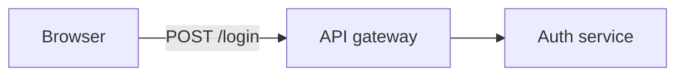

# docs-manager

Treat your markdown documentation as a **product**: auto-generated navigation, link checking, and a
small set of conventions that keep docs DRY and always reflecting the current state.

## What it gives you

- **`_index.md` navigation tree** — every folder gets an auto-generated index of its sub-folders and
  docs (with one-line descriptions harvested from frontmatter). Dot-folders such as `.git/` are
  skipped, so `docs/` can be a git repository of its own.
- **Link checking** — finds broken relative cross-doc links.
- **Diagrams** — a diagram lives in a text `*.diagram.md` source; the tool copies it into every
  doc that asks for it and keeps it current. Nothing is rendered and nothing is installed: a
  fenced block is already drawn by the viewer (GitHub, VS Code, JetBrains, Obsidian).
- **Diagram refs** — a diagram can point at the code, docs, tasks and terms it depicts, rendered as
  checked links and validated alongside every other cross-doc link.
- **Diagram staleness** — a diagram declares what it depicts and flags itself as *suspect* when that
  changes, with a hook that says so the moment you edit a watched file.
- **A how-to for ERDs** — entity-relationship diagrams are the one form no checker can validate, so
  the skill ships [`how-to-erd.md`](skills/docs-manager/references/how-to-erd.md) and reads it before
  drawing one: transcribe every declared prop, no empty boxes, every edge a join that could actually
  happen, plus the `erDiagram` parse traps and a checklist to run before `bless`.
- **A method for the agent instruction file** — `CLAUDE.md` / `AGENTS.md` is read before every task, so
  it fills up with the project's knowledge, which the docs should own. The skill ships
  [`how-to-claude-md.md`](skills/docs-manager/references/how-to-claude-md.md): the instruction-vs-knowledge
  test, where each kind of knowledge goes, the block-by-block extraction procedure, a mechanical check
  that nothing was lost, and a checklist.
- **External docs** — drop a vendor PDF, a Word contract or a spreadsheet into `docs/external/` and
  it gets a **card**: a doc beside it saying what it holds, when to read it and where inside it to
  look (pages, headings, sheets). Cards are indexed like any doc; `check` reports files with no
  card, cards gone stale since the file changed, and cards whose file is gone — and under a changed
  file, every doc that depends on it. A `.docx` or `.xlsx` is read with `unzip` + awk (headings,
  sheets, header rows, plain text); anything unreadable falls back to a card written from what you say.
- **Conventions** — docs reflect current state (history lives in tasks), single source of truth,
  cross-link instead of duplicate, frontmatter on every doc, and SOLID read for docs (one purpose per
  doc and folder, grow by adding, one shape per kind, entry points per reader).

Runtime-free: the tool uses only `bash` + `awk`, so it runs anywhere (including restricted/Docker
environments where no language runtime is allowed).

## Usage

```bash
# Regenerate all _index.md files (default root: ./docs)
bash scripts/docs.sh index --write

# Verify only (CI / pre-commit) — non-zero exit on drift
bash scripts/docs.sh index --check

# Report broken relative links
bash scripts/docs.sh links

# Regenerate diagram blocks in docs
bash scripts/docs.sh diagram index --write
bash scripts/docs.sh diagram index --check

# Staleness: report suspect diagrams, and record a review
bash scripts/docs.sh diagram check
bash scripts/docs.sh diagram bless auth-flow

# Optional: run the project's own render script, if it has one
bash scripts/docs.sh diagram render

# External docs: which files need a card, record a reviewed card, file one away
bash scripts/docs.sh external status
bash scripts/docs.sh external check
bash scripts/docs.sh external stamp docs/external/vendor/spec.pdf
bash scripts/docs.sh external move docs/external/spec.pdf docs/external/vendor
# …which docs depend on a file; what is inside a docx/xlsx
bash scripts/docs.sh external related docs/external/vendor/spec.pdf
bash scripts/docs.sh external outline docs/external/finance/budget.xlsx
bash scripts/docs.sh external text docs/external/law/contract.docx

# All checks
bash scripts/docs.sh check
```

Pass a different root as the last argument, e.g. `bash scripts/docs.sh check documentation`.

## Doc frontmatter

```yaml
---
title: Short title
description: One line — shown in the parent _index.md listing.
---
```

## Diagrams

A diagram lives in its own **source** file, `<name>.diagram.md` — frontmatter plus exactly one fenced
code block:

````markdown
---
title: Auth flow
---


````

A doc opts in by placing a marker where the diagram should appear:

```markdown
<!-- DIAGRAM:auth-flow.diagram.md -->
```

`docs.sh diagram index --write` then splices the fence in below it, between
`AUTO-DIAGRAM:START` / `END` markers. Text outside the markers is preserved; re-running changes
nothing. Edit the source, never the generated block.

The marker is the only place the link is declared — it says *which* diagram and *where* it goes — so
renaming a doc never leaves a second declaration behind. Several docs may embed the same source; each
gets its own copy.

**The fence is never parsed.** The language tag is yours: `mermaid`, `d2`, `dot`, `plantuml` all work
identically, because the tool copies and the *viewer* draws. That is why this needs no renderer, no
Node, no Docker and no install step.

Diagram sources are excluded from `_index.md` listings — they are input to a generated block,
not documents in their own right.

Drawing an **ERD**? Read [`how-to-erd.md`](skills/docs-manager/references/how-to-erd.md) first —
nothing in this tool can tell a correct ERD from a confident, well-formed, wrong one.

### References

A source can point at the things it depicts. Add a `refs:` map to its frontmatter:

```yaml
---
title: Auth flow
refs:
  api:   file:../src/api/gateway.ts "API gateway"
  store: term:./glossary.md#refresh-token
  spec:  url:https://example.com/rfc
---
```

The generated block gains a caption line below the fence:

```markdown
**References** — [API gateway](../src/api/gateway.ts) · [`store`](glossary.md#refresh-token) · [`spec`](https://example.com/rfc)
```

- **Paths are relative to the `.diagram.md` file**, like any markdown link — so there is no config
  file, and no notion of a project root to get wrong.
- **Each embedding doc gets its own href.** The same source embedded at two depths produces
  `../src/…` in one doc and `../../src/…` in the other. Write the path once, from the source.
- **The key is the label**, unless you add a quoted one. Keep the key matching your diagram's node id.
- **Schemes**: `file:` `doc:` `task:` `term:` `diagram:` all resolve as paths and are checked by
  `docs.sh links`; `url:` is emitted as-is and **never fetched**.

Why a caption list and not clickable nodes? GitHub strips Mermaid's `click` directive, so a caption
is the only form that works where people actually read the doc — and it is greppable, diffable and
visible without hovering.

### Staleness

A stale diagram is worse than no diagram, because a reader trusts it. No tool can verify that a
picture still matches reality, so docs-manager does the honest thing instead: a source declares
**what it depicts**, and the tool flags it as *suspect* when that changes.

```yaml
---
title: Auth flow
watch: [../src/auth/, ../src/api/gateway.ts]
stamp: 4272921961        # written by `bless`, never by hand
---
```

A trailing `/` means "this directory, recursively"; anything else is an exact file. No globs.

```bash
docs.sh diagram check              # report stale diagrams; non-zero exit for CI
docs.sh diagram bless auth-flow    # "I reviewed it, it is correct now"
```

When a watched file changes, every doc embedding the diagram grows a notice under it:

```markdown
⚠ *may be stale — watched files changed since this diagram was last reviewed*
```

Rules worth knowing:

- **`bless` is the only thing that writes `stamp:`.** No command re-stamps as a side effect — the
  moment one does, staleness stops meaning anything.
- **No `watch:` means never stale.** Staleness is opt-in per diagram.
- **A watched diagram that has never been blessed is stale**, reported as "never blessed". A new
  diagram genuinely has not been reviewed against the code yet.
- **Renames and deletions count**, not just edits — the path is part of the fingerprint.
- **Stamps are portable.** The digest uses paths relative to the source, so it is identical on every
  machine and safe to commit; a stamp blessed on macOS verifies clean on Linux CI.

### The hook

Installing the plugin registers a `PostToolUse` hook. When Claude edits a file that some diagram
watches, it says so immediately:

```
docs-manager: src/auth/service.ts is watched by docs/auth-flow.diagram.md — the diagram may now be wrong.
  review it, then: docs.sh diagram bless auth-flow
```

That is the point of the whole feature: the moment right after the code changed is the only moment
the diagram realistically gets fixed. The hook never writes anything, never blocks the edit, and
always exits 0. Projects with no `docs/` directory or no diagram sources pay a single `find` and stop.

A hook receives no command-line arguments, so if your docs live somewhere other than `docs/`, tell it
with an environment variable:

```bash
DOCS_MANAGER_ROOT=documentation
```

This is the plugin's only setting, and it exists solely because the hook cannot be passed a root the
way every command can. There is no config file.

### Optional: rendering a standalone artifact

The caption list works everywhere with no toolchain, and that is the default. If you additionally
want a rendered file — clickable nodes, print, offline — drop an **executable script** at
`docs/.docs-manager-render`:

```
.docs-manager-render  <source-path>  <out-basename>
```

Write `<out-basename>.svg` (or `.png`, `.pdf`, `.webp`, `.html`) and exit non-zero on failure.
First match in that order wins, so do not write both an `.svg` and an `.html`. Then:

```bash
docs.sh diagram render        # runs your script over every source
docs.sh diagram index --write # links any artifact it finds, per embedding doc
```

Rendering is explicit and linking is automatic, deliberately: `index` will never silently shell out
to a container on a routine run. Each embedding doc links the artifact at its own relative path.

**The plugin ships no renderer, pulls nothing and installs nothing.** Your script owns the tool, its
version pinning, and its security surface — which is also why anything language-specific (Mermaid's
`click`, D2's `link:`, theming) belongs in your script: it receives the source path and has the whole
file in front of it. The plugin never parses the fence.

If the script is absent, every command succeeds and nothing is rendered. If it fails, the failure is
reported, any previous artifact is left alone, and `index` still writes the block — rendering is
never on the critical path for a readable doc.

Working recipes for mermaid-cli, D2 and self-hosted Kroki — plus the argument contract, the failure
semantics and a setup checklist — are in
[`skills/docs-manager/references/how-to-render.md`](skills/docs-manager/references/how-to-render.md).
They are examples to adapt, not supported integrations.


## External docs

A PDF, a `.docx` or an `.xlsx` cannot be grepped and is expensive to read whole, so on its own it is
close to invisible to an agent. Each one gets a card beside it — `spec.pdf` → `spec.pdf.md` — with a
summary, `read-when:` situations, and a **Where to look** table mapping topics to pages, headings or
sheets. A later session reads the card, then opens exactly pages 31–38.

```
docs/external/
├── payments-spec.pdf          ← just dropped in: not yet filed
└── vendor-api/
    ├── payments-spec-v3.pdf
    └── payments-spec-v3.pdf.md
```

- **`docs/external/` is a convention, not a setting.** Files dropped at its top level are filed into
  a topic folder when catalogued; one found elsewhere under `docs/` is still detected.
- **`digest:` makes staleness real.** `external stamp` records the sha256 of the file's bytes once the
  card has been reviewed; replace the file and `check` reports the card as `CHANGED`.
- **A changed file names its dependants.** Under each `CHANGED` line `check` prints `REVIEW:` for
  every doc in the card's `relates-to:` and every doc linking to the card or the file.
- **docx and xlsx are read without a runtime.** They are zip packages of XML, so `external outline`
  and `external text` use `unzip` (macOS and busybox ship it) and awk. Other formats, or no `unzip`,
  give a `none` record and the card is written from a PDF export or a description.
- **Recognised extensions:** `pdf doc docx xls xlsx ppt pptx odt ods odp rtf epub`. A `.pdf` rendered
  from a diagram source beside it is output, not reference material, and is ignored.
- Files you place in the project are committed as they are; the plugin only ever writes cards.

Card format and the cataloguing procedure: [`how-to-external-docs.md`](skills/docs-manager/references/how-to-external-docs.md).

## The agent instruction file (CLAUDE.md / AGENTS.md)

That file is read **in full, before every task**, which is both its value and the reason it decays:
anything learned is easiest to put where it will certainly be read. Over a few months it stops being
instructions and becomes a second, worse copy of the documentation — system descriptions, module names,
invariants — condensed until nobody can tell whether a line is still true, and duplicated from docs that
say it better.

Nothing in this tool can detect that. `index`, `links` and `check` all pass on a thousand-line instruction
file that contradicts the docs beside it.

The split the skill applies:

| | Belongs in |
|---|---|
| how to work — what to run, what never to do, when to ask, the task and git workflow | the instruction file |
| anything true about the project — how a system works, why, what a module is called, what a test guards | `docs/`, in the doc that owns the subject |

The instruction file then keeps **one pointer table**: subject → the doc that owns its rules. Docs get the
knowledge in their own voice, usually in the doc's decision record, plus a **§Code anchors** section for
the rule → module/test mapping that instruction files tend to be the only place holding.

Full method — the test, the extraction procedure, the mechanical "nothing was lost" check and a
checklist — is [`how-to-claude-md.md`](skills/docs-manager/references/how-to-claude-md.md). The skill
reads it before touching such a file, including for a single *"where does this rule go?"* decision, since
that decision repeated is how the large problem is built.

## Testing

```bash
bash scripts/test/diagram.test.sh                                    # host
docker run --rm -v "$PWD":/w -w /w bash:5 bash scripts/test/diagram.test.sh   # container
# same two targets for scripts/test/external.test.sh
```

Run both: the host target (macOS `bash` 3.2 + BSD userland) and the container target (bash 5 + GNU
coreutils) catch different portability bugs.

## Install

```shell
/plugin marketplace add vatvit/claude-plugins
/plugin install docs-manager@vatvit-plugins
```

When installed, invoke the tool as `bash <PLUGIN_ROOT>/scripts/docs.sh …` (the skill resolves the path).

## License

MIT
