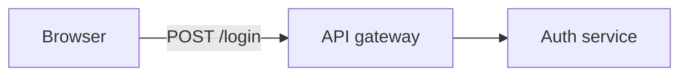

# docs-manager

Treat your markdown documentation as a **product**: auto-generated navigation, link checking, and a
small set of conventions that keep docs DRY and always reflecting the current state.

## What it gives you

- **`_index.md` navigation tree** — every folder gets an auto-generated index of its sub-folders and
  docs (with one-line descriptions harvested from frontmatter).
- **Link checking** — finds broken relative cross-doc links.
- **Diagrams** — a diagram lives in a text `*.diagram.md` source; the tool copies it into every
  doc that asks for it and keeps it current. Nothing is rendered and nothing is installed: a
  fenced block is already drawn by the viewer (GitHub, VS Code, JetBrains, Obsidian).
- **Conventions** — docs reflect current state (history lives in tasks), single source of truth,
  cross-link instead of duplicate, frontmatter on every doc.

Runtime-free: the tool uses only `bash` + `awk`, so it runs anywhere (including restricted/Docker
environments where no language runtime is allowed).

## Usage

```bash
# Regenerate all _index.md files (default root: ./docs)
bash scripts/docs.sh index --write

# Verify only (CI / pre-commit) — non-zero exit on drift
bash scripts/docs.sh index --check

# Report broken relative links
bash scripts/docs.sh links

# Regenerate diagram blocks in docs
bash scripts/docs.sh diagram index --write
bash scripts/docs.sh diagram index --check

# All checks
bash scripts/docs.sh check
```

Pass a different root as the last argument, e.g. `bash scripts/docs.sh check documentation`.

## Doc frontmatter

```yaml
---
title: Short title
description: One line — shown in the parent _index.md listing.
---
```

## Diagrams

A diagram lives in its own **source** file, `<name>.diagram.md` — frontmatter plus exactly one fenced
code block:

````markdown
---
title: Auth flow
---


````

A doc opts in by placing a marker where the diagram should appear:

```markdown
<!-- DIAGRAM:auth-flow.diagram.md -->
```

`docs.sh diagram index --write` then splices the fence in below it, between
`AUTO-DIAGRAM:START` / `END` markers. Text outside the markers is preserved; re-running changes
nothing. Edit the source, never the generated block.

The marker is the only place the link is declared — it says *which* diagram and *where* it goes — so
renaming a doc never leaves a second declaration behind. Several docs may embed the same source; each
gets its own copy.

**The fence is never parsed.** The language tag is yours: `mermaid`, `d2`, `dot`, `plantuml` all work
identically, because the tool copies and the *viewer* draws. That is why this needs no renderer, no
Node, no Docker and no install step.

### References

A source can point at the things it depicts. Add a `refs:` map to its frontmatter:

```yaml
---
title: Auth flow
refs:
  api:   file:../src/api/gateway.ts "API gateway"
  store: term:./glossary.md#refresh-token
  spec:  url:https://example.com/rfc
---
```

The generated block gains a caption line below the fence:

```markdown
**References** — [API gateway](../src/api/gateway.ts) · [`store`](glossary.md#refresh-token) · [`spec`](https://example.com/rfc)
```

- **Paths are relative to the `.diagram.md` file**, like any markdown link — so there is no config
  file, and no notion of a project root to get wrong.
- **Each embedding doc gets its own href.** The same source embedded at two depths produces
  `../src/…` in one doc and `../../src/…` in the other. Write the path once, from the source.
- **The key is the label**, unless you add a quoted one. Keep the key matching your diagram's node id.
- **Schemes**: `file:` `doc:` `task:` `term:` `diagram:` all resolve as paths and are checked by
  `docs.sh links`; `url:` is emitted as-is and **never fetched**.

Why a caption list and not clickable nodes? GitHub strips Mermaid's `click` directive, so a caption
is the only form that works where people actually read the doc — and it is greppable, diffable and
visible without hovering.

Diagram sources are excluded from `_index.md` listings — they are input to a generated block, not
documents in their own right.

## Testing

```bash
bash scripts/test/diagram.test.sh                                    # host
docker run --rm -v "$PWD":/w -w /w bash:5 bash scripts/test/diagram.test.sh   # container
```

Run both: the host target (macOS `bash` 3.2 + BSD userland) and the container target (bash 5 + GNU
coreutils) catch different portability bugs.

## Install

```shell
/plugin marketplace add vatvit/claude-plugins
/plugin install docs-manager@vatvit-plugins
```

When installed, invoke the tool as `bash <PLUGIN_ROOT>/scripts/docs.sh …` (the skill resolves the path).

## License

MIT
