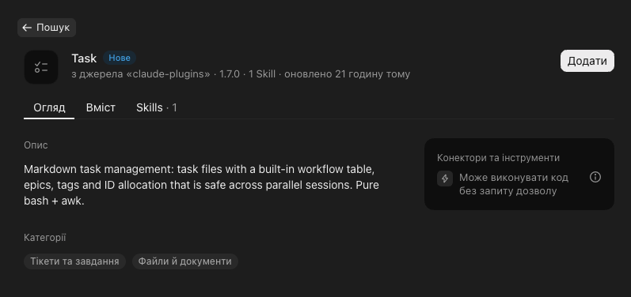
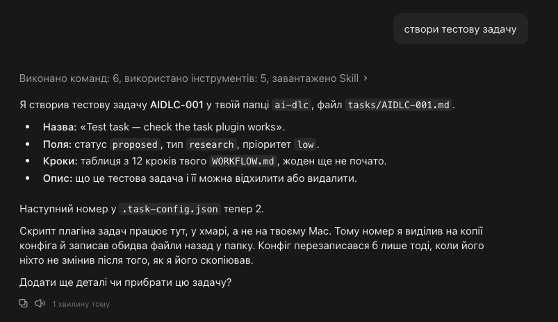
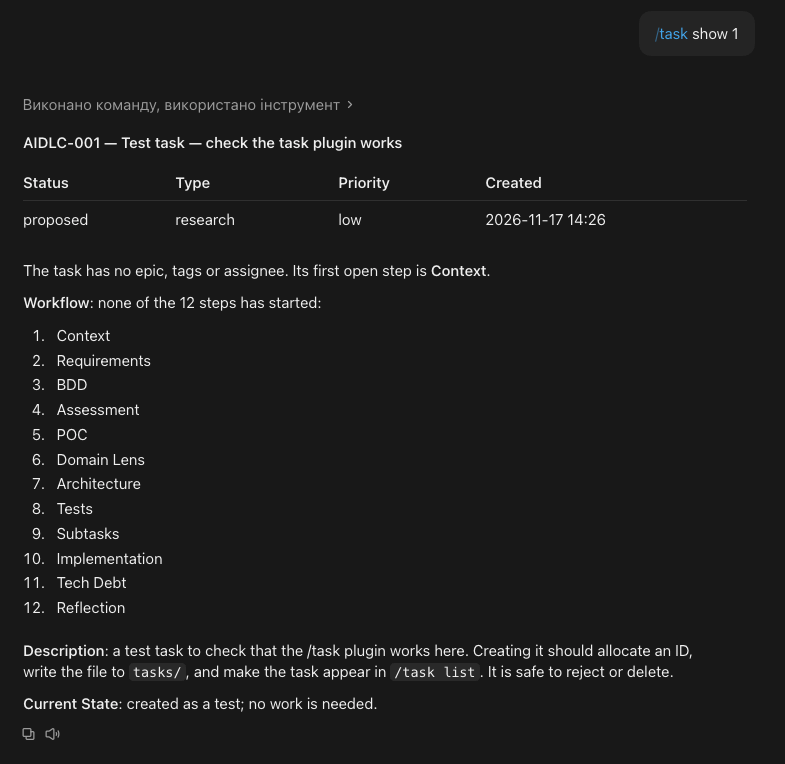
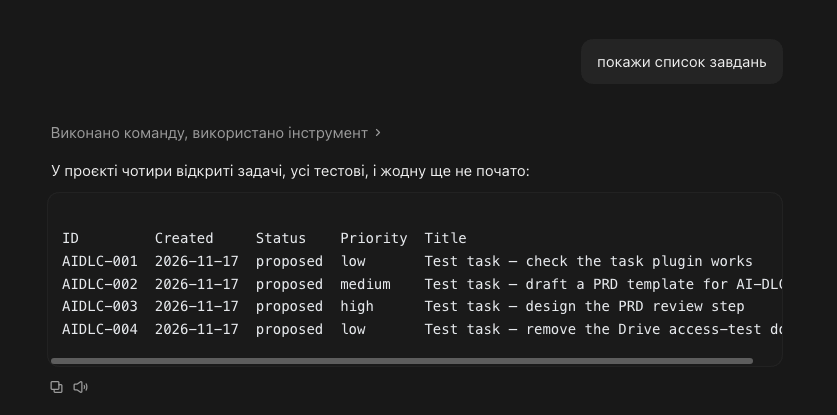

# Як планувати роботу разом із Claude

*Частина 2: плагін task у Claude Desktop*

Щоб не тримати все в голові, пропонуємо плагін **task**. Він дозволяє розписати план робіт — для
себе або для Claude, — бачити, що вже зроблено, а ідеї, які з'являються посеред роботи,
відкладати на потім, щоб вони не губилися і не відволікали.

Працює це просто. Кожна задача — окремий текстовий файл у папці задач, наприклад `WORK-007.md`.
Номер видається автоматично. У задачі є статус (запропоновано, погоджено, в роботі, заблоковано,
завершено, відхилено) і таблиця кроків, а в розділі «Поточний стан» Claude лишає нотатку для
наступної розмови: що зроблено і що далі. Тож завтра він продовжить з того самого місця.

**І головне: задачі не прив'язані до проєкту.** Папку задач можна тримати де завгодно, зокрема
поза будь-яким проєктом. Тож task годиться для чого завгодно: робочих справ і особистих, навчання,
переїзду, підготовки події, власного маленького бізнесу. Будь-який проєкт, будь-які задачі, а не
лише програмування.

## Встановлюємо

Якщо ви вже пройшли Частину 1, маркетплейс у вас є. Відкрийте **Налаштування → Плагіни →
Огляд**, знайдіть **Task** і натисніть **«Додати»**.

Зверніть увагу на підпис **«з джерела «claude-plugins»»**: так Cowork називає наш маркетплейс.
Плагін з такою самою назвою, але з іншого джерела — це інший плагін. А попередження «може
виконувати код без запиту дозволу» стосується невеликих допоміжних програм усередині плагіна:
ними він, наприклад, видає номери задач.

Почніть нову розмову і скажіть Claude: «Створи задачу: …що зробити…». Оскільки це перша задача,
Claude спершу спитає три речі. Відповіді він запише у файл `.task-config.json` у папці, з якою
працює, і більше їх не питатиме.

**Де зберігати задачі.** Найпростіше — підпапка, наприклад `tasks`. Але можна вказати повний шлях
до будь-якої іншої папки: однієї для всіх ваших задач, робочих і особистих, або окремої під кожну
справу. Тільки Claude має мати до неї доступ — у Cowork відкрийте йому і цю папку, інакше в
наступній розмові він задач не знайде.

**Префікс номерів.** Коротке слово великими літерами: `WORK` → `WORK-001`, `WORK-002`. Обирайте
одразу й надовго: якщо змінити префікс, коли задачі вже є, старі не перейменуються. Для різних
справ із різними папками задач беріть різні префікси, щоб номери не плутались.

**Ви самі чи команда.** Працюєте самі — відповідайте «сам(а)». Команда — окрема історія, про неї
нижче.

Готово — у папці задач з'явилася перша задача.

А так виглядає сама задача: статус, тип і кроки, жоден з яких ще не почато.

## Як користуватися

Далі все звичайними фразами. Прийшла ідея, але не зараз — скажіть «Відклади ідею: …ідея…», і вона
чекатиме своєї черги. Хочете побачити, що є, — «Покажи мої задачі». Подивитися одну — «Що в
задачі 7?».

Коли готові братися — «Візьмися за задачу 7»: Claude поставить її в роботу і йтиме крок за
кроком, питаючи перед кожним наступним. А якщо хочете, щоб він довів задачу до кінця без пауз, —
«Заверши задачу 7»: Claude один раз перепитає, а потім пройде всі кроки, що лишилися, і закриє
задачу.

Для великої справи можна створити епік — задачу, що об'єднує кілька менших: «Створи епік:
…велика мета…». Claude допоможе сформулювати мету й поділити роботу на частини.

Хто звик до команд, може писати й так: `/task create`, `/task list`, `/task do 7` — це те саме.

## Налаштовуємо під себе

**Кроки.** Типові кроки задачі створені для програмування (вимоги, архітектура, тести). Попросіть
Claude: «Налаштуй кроки задач під мою роботу: …ваші кроки…» — і він створить у папці задач
власний список. Наприклад:

- маркетинг: бриф → чернетка → погодження → публікація → результати;
- юридична робота: збір матеріалів → чернетка → перевірка → погодження → підписання;
- аналітика: питання → збір даних → аналіз → висновки → презентація.

Кожен крок можна ще й докладно описати — і Claude виконуватиме його саме так. Кроки спільні для
всієї папки задач: якщо для різних справ потрібні різні кроки, заведіть для них різні папки.

**Типи.** Тип — це позначка, за якою задачі легко відфільтрувати. Типові типи теж програмістські,
але можна домовитися про свої: «звіт», «зустріч», «дослідження», «лист». Наприклад: «Створи
задачу типу „звіт“: …», а потім «Покажи всі задачі типу „звіт“».

## Сам чи з командою

**Самостійно.** Задачі — ваші особисті нотатки, тож нікуди їх не публікуйте. Якщо папка, де вони
лежать, — git-репозиторій (git — програмістська система для історії змін), попросіть Claude
додати папку задач до `.gitignore`, щоб вони не потрапили в спільну історію. Або просто тримайте
задачі поза такою папкою. Командні можливості вимкнені, доки ви самі їх не попросите.

**З командою — лише через git.** Вести спільні задачі з колегами можна, але тільки тоді, коли
задачі лежать у git-репозиторії, спільному для всіх. Без нього двоє людей легко створять дві різні
задачі з одним номером або перезапишуть правки одне одного, і ніхто цього не помітить. З git:

- номери задач резервуються через спільне сховище («Перемкни номери задач на git»), тож однакових
  номерів не буде навіть на різних комп'ютерах. Якщо дубль усе ж з'явився, скажіть «Дві задачі з
  однаковим номером» — Claude перенумерує одну з них;
- одночасні зміни однієї задачі git покаже як конфлікт, який треба розв'язати, а не тихо загубить;
- у задач з'являються відповідальні («Увімкни відповідальних за задачі»). Є два варіанти: нові
  задачі з'являються **нічиїми**, і хтось бере їх собі, або одразу **належать тому, хто їх
  створив**. Тоді «Покажи мої задачі» показує ваші та нікому не призначені.

Позначає вас Claude email-ом вашого облікового запису Claude, а якщо не знає його — спитає email
або ім'я. Майте на увазі: у призначених вам задачах це позначення бачитиме вся команда.

Якщо git у вас немає, попросіть технічного колегу його налаштувати, а доти ведіть задачі кожен для
себе.

## Кілька порад

- **Формулюйте задачу як результат**, який можна показати: «зробити Х», а не «займатися Х».
- **На початку розмови** питайте «Що в мене в роботі?» — і Claude підхопить, де ви зупинились.
  Перед перервою попросіть оновити «Поточний стан».
- **Знання — у документах, а не в задачах.** Те, що варто пам'ятати надовго, переносьте в
  документи `docs` (Частина 1): задача каже, що зробити, а документи — як усе влаштовано.
- **Змінюйте все через Claude.** Не правте вручну файл налаштувань `.task-config.json` — зокрема
  номер наступної задачі в ньому веде сам плагін.
- **Статус задачі — ваше рішення.** Claude змінює його лише тоді, коли ви про це просите (зокрема
  фразами «Візьмися…» чи «Заверши…»), і сам задачі не закриває й не відхиляє.
